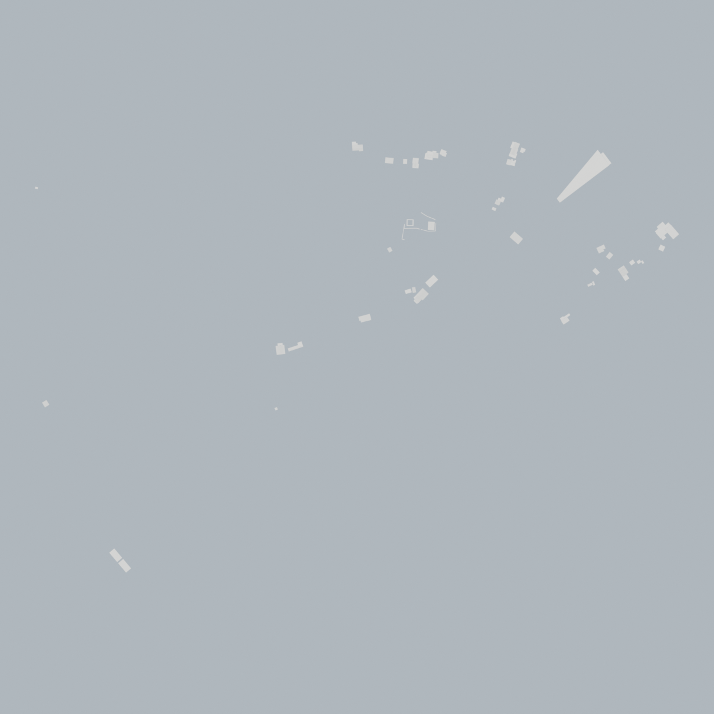

# SWISSBuildings → Blender

[](https://www.blender.org/)
[](https://www.python.org/)
[](LICENSE.md)
[](https://pypi.org/project/lxml/)
[](#credits)

> **For when any other CityGML importer is just way too heavy.**

A lean Blender add-on that imports [Swisstopo SWISSBuildings 3D](https://shop.swisstopo.ch/) tiles (CityGML, dataset version ≥ 3.0) straight into your scene — no heavyweight CityGML pipeline, no external services, no plugins beyond the standard Blender Python API.


*Imported `demo_Hinterrhein.gml` tile — one collection per building, with separate wall / roof / ground surface meshes.*


*Same tile, top-down: the per-building footprint layout as it comes off the import.*

---

## Why this exists

Most CityGML workflows drag in a large, general-purpose import stack. This add-on targets one specific, well-defined source — Swisstopo's `SWISSBuildings` tiles — and optimises for exactly that:

- **Fast & light.** Only what the importer needs: `lxml` for parsing, `numpy` for vectorised coordinates, and Blender's built-in `bmesh` for mesh construction.
- **Accurate at Swiss scale.** Swiss coordinates are in [LV95](https://en.wikipedia.org/wiki/Swiss_coordinate_system) with magnitudes around `2.7 × 10⁶ m`. Blender stores meshes and object transforms in `float32`, which at that magnitude only resolves **~10–25 cm steps**. The add-on re-centres every tile on its own bounding-box centre (keeping `z` absolute) so geometry lands with **sub-millimetre** precision.
- **Multi-tile aware.** The first tile you import defines the scene's world origin. Subsequent tiles are offset by the *same* anchor, so multiple tiles drop in at their correct relative position with the shared LV95 height datum.
- **Non-destructive re-import.** Importing the same file again *replaces* its collection rather than duplicating it.

## Features

| | |
|---|---|
| 🏠 **Per-building structure** | One root collection (named after the file) → one collection per building → one mesh object each for `WallSurface`, `RoofSurface`, `GroundSurface`, parented to a per-building empty. |
| 🗂 **`.gml` or `.zip`** | Pass a plain `.gml` file *or* a `.zip` archive containing a single `.gml`. Archives are decompressed **in RAM** — nothing is written to disk. |
| 🎯 **Auto-centred** | Geometry is centred on the tile's bounding-box centre (x/y), height stays on the absolute LV95 datum. |
| ⚡ **Progress reporting** | Live progress bar while meshes are built. |
| ✅ **Headless-verifiable** | A standalone harness (`tools/headless_check.py`) validates import, centering, idempotency and `.gml`≡`.zip` equivalence without a GUI. |

---

## Requirements

- **Blender 5.2.0 LTS** or newer (add-on `blender_version_min = 5.2.0`).
- A `SWISSBuildings 3D` dataset file, **version ≥ 3.0** (older versions lack the tile bounding-box metadata this importer relies on).
- That's it. `lxml` and `numpy` ship with Blender's Python runtime, so **no extra Python setup is needed inside Blender**.

## Installation

### From the Blender Extensions platform *(recommended)*

1. In Blender, go to **Edit → Preferences → Get Extensions**.
2. Search for **Swisstopo SWISSBuildings Importer**.
3. Click **Install**.

### Manually (from source)

```bash
git clone git@git.safmod.ch:core-team/swissbuildings_2_blender.git
cd swissbuildings_2_blender
# either install as a pack, or just point Blender at the folder:
blender -b --factory-startup \
  --python-expr "import bpy; bpy.ops.extensions.repo_add" 2>/dev/null || true
```

Or in the GUI: **Edit → Preferences → Add-ons → Install…**, then select the repository folder. The add-on's manifest is in [`blender_manifest.toml`](blender_manifest.toml).

## Usage

1. Open Blender (≥ 5.2.0).
2. **File → Import → SWISSBuildings (.gml)** — or press `F3` and search *"SWISSBuildings"*.
3. Pick a `.gml` file or a `.zip` archive containing one.
4. Done. A new collection appears in the outliner named after the file.

```
Scene Collection
└── demo_Hinterrhein                 # one per imported file
    ├── ID_05E0E78F-…                # per-building collection (+ empty)
    │   ├── ID_05E0E78F-…_WallSurface
    │   ├── ID_05E0E78F-…_RoofSurface
    │   └── ID_05E0E78F-…_GroundSurface
    ├── ID_1478DAEC-…
    │   └── …
    └── …
```

> **Re-anchoring the origin.** The first tile imported sets the scene's world origin (the ground point under its bounding-box centre maps to `(0,0,0)`). To re-anchor on a different tile, delete `context.scene["swissbuildings_world_origin"]` and import that tile.

### What gets imported

The importer creates mesh objects for the **`WallSurface`**, **`RoofSurface`** and **`GroundSurface`** components of each building. `lod2Solid` is *deliberately* skipped — extend the `SURFACE_TYPES` tuple in [`__init__.py`](__init__.py) to include more.

All faces are smooth-shaded; edges whose adjacent-face angle exceeds `30°` are marked sharp (so roof ridges stay crisp while walls stay smooth).

## How it works

```
 .gml / .zip  ──▶  SwissBUILDINGS3d_Parser (lxml + numpy)
                          │
                          │  dict[str, Building] + tiledata
                          ▼
                 import_swissbuildings(context, filepath)
                          │
                          ├─ x/y centred on tile bbox centre, z kept absolute
                          ├─ one collection per building, one empty per building
                          └─ one bmesh-built mesh per surface (wall/roof/ground)
```

- [`parser.py`](parser.py) — the CityGML/SWISSBuildings parser. Streams the GML into a typed `Building` structure, keeping coordinates in `float64` until the final step.
- [`tooling.py`](tooling.py) — the data model: `Building`, `Surface`, `Polygon`, `Vertex`, `AABB_BoundingBox`, and a `Version` type for dataset-version comparison.
- [`implicit_mapping.py`](implicit_mapping.py) — a small wrapper that lets you treat a *collection* of buildings as a single object (vectorised attribute access / arithmetic across all of them).
- [`__init__.py`](__init__.py) — the Blender add-on: the import operator, the file browser entry, and the mesh-building + centring logic.
- [`tools/headless_check.py`](tools/headless_check.py) — the headless validation harness.

### Precision notes

- Coordinates are held in **`float64`** through the entire parse and only converted to `float32` at the very end (when Blender meshes are created), *after* being made relative to the tile centre. This is what keeps Swiss-scale geometry exact.
- `z` is **not** re-centred: the tile's vertical envelope is just its own min/max height, not a datum, so subtracting it would sink the tile to an arbitrary level. Keeping `z` absolute means every imported tile shares the LV95 height system (metres above HÖH).

## Development

```bash
# parser-only check (no Blender required — uses the project venv)
uv run python tools/headless_check.py -- demofiles/demo_Hinterrhein.gml

# full check through Blender (creates real mesh objects)
blender -b --factory-startup --python tools/headless_check.py -- \
    demofiles/demo_2_multitile.gml demofiles/demo_2_multitile.zip
```

The harness verifies: import completes, expected object counts, x/y centring, re-import idempotency, and `.gml` ≡ `.zip` equivalence. Exit code `0` = pass.

> `demofiles/` is **not** committed (it's in `.gitignore`). The files above are local samples — swap in your own tiles.

## License

[GPL-3.0-or-later](LICENSE).

## Credits

- [Swisstopo](https://www.swisstopo.ch/) — the [SWISSBuildings 3D](https://shop.swisstopo.ch/) dataset.
- [Blender](https://www.blender.org/) — the host application.
- Maintained by [chuppy](WIP).

### A note on AI-assisted development

The **parser** ([`parser.py`](parser.py)) is handwritten by a human for quality control — it is the part of the codebase where correctness matters most and where a generated result is most likely to look right while being subtly wrong. Everything else — the Blender bridge ([`__init__.py`](__init__.py)), the headless verification harness (`tools/headless_check.py`), this documentation, and the surrounding scaffolding — was AI-assisted, reviewed, and merged by a human. If you spot a place where that trade-off shows, open an issue.
